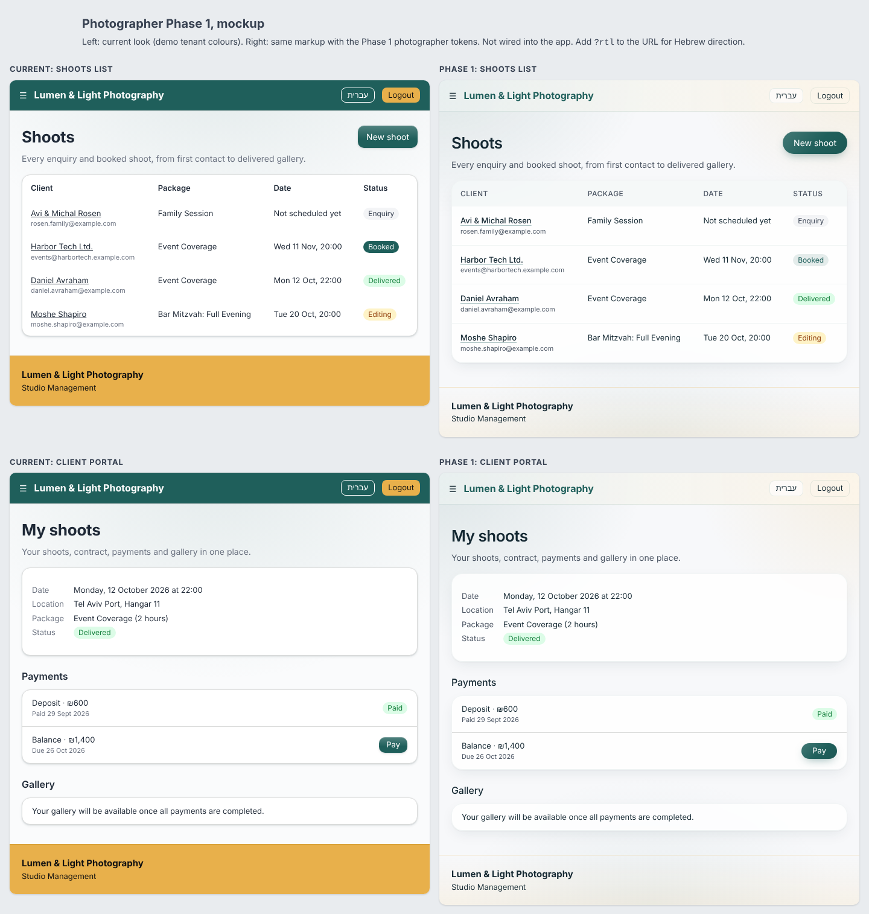

# Photographer theme proposal: a softer, gradient-led look

> Status: research and proposal only. No app code is changed by this PR.
> Scope: photographer vertical (`tenants.skin = 'photographer'`). The dance-studio look must not change.
> Date: 2026-10-30

## Summary

- **The two references could not be studied.** This session's network policy blocked `lightbluesoftware.com`, `www.lightbluesoftware.com`, `opalswift.com`, `www.opalswift.com` and `web.archive.org` (proxy answered 403 to CONNECT, and server-side fetch could not resolve them). Following the brief, I did **not** reconstruct their design from memory. The "what they do" columns below are empty until someone captures them. `docs/design/research/capture-references.js` is ready to run once the hosts are allowed (it saves screenshots at 1280/390 and extracts computed colours, gradients, fonts, radii, shadows and motion to JSON).
- **Our side is fully captured.** Photographer demo screenshots (shoots list, shoot detail, quote, client portal, pay page, at 1280 and 390, plus Hebrew RTL) are in `docs/design/research/ours/`.
- **The proposal follows the owner's brief** ("subtle gradient colouring") and our own finish layer, which already has the parts needed: `--wash-brand`, the `--tint-primary-*` ramp, tinted shadows and sheen overlays. What makes the current photographer screens feel heavy is not missing gradients. It is the **solid teal header and solid mustard footer**: two full-width, fully saturated bars at the top and bottom of every page. Phase 1 replaces them with light, tinted, gradient chrome and adds a multi-stop background wash and translucent cards.
- **Everything is scoped to `html[data-vertical="photographer"]`.** Dance tenants never get the attribute, so they get none of these rules.
- **One contrast problem to fix along the way:** our muted text `#6b7280` drops to **4.28:1** on an 8% primary tint, below AA. The photographer scope switches muted text to `#4b5563` (6.3:1 even on a 12% tint).
- A throwaway mockup (`docs/design/photographer-phase1-mockup.html`) shows the shoots list and client portal, current vs Phase 1, side by side.



---

## 1. Reference sites: not captured

| Host | Result | Detail |
|---|---|---|
| `lightbluesoftware.com`, `www.lightbluesoftware.com` | Blocked | Agent proxy: `CONNECT tunnel failed, response 403` (policy denial). WebFetch: `ENOTFOUND`. |
| `opalswift.com`, `www.opalswift.com` | Blocked | Same as above. |
| `web.archive.org` (fallback) | Blocked | Proxy 403. |

**To unblock:** in the cloud environment settings (environment menu in the session title bar, then Edit), add these hosts under Network access → Allowed domains, or pick a broader access level. See https://code.claude.com/docs/en/cloud-environments#network-access. Then run:

```sh
NODE_PATH=$(npm root -g) node docs/design/research/capture-references.js
```

and fill the empty "Reference" column in section 3. Proposals in section 4 marked **(verify)** are the ones most likely to need tuning against the real references (exact hue of the gradients, typeface choice, radius).

---

## 2. Our current system (what exists today)

Sources: `DESIGN_SYSTEM.md`, `apps/web/DESIGN_SYSTEM.md`, `apps/web/src/index.css`, `useThemeInjection.ts`, `useFontLoader.ts`, `tailwind.config.js`, `components/ui/*`, `layouts/AppLayout.tsx`, `components/Navigation/AppHeader.tsx`.

| Layer | What we have | Notes |
|---|---|---|
| Colour primitives | `--color-primary/secondary` + hover/active/light, written at runtime by `useThemeInjection()` from `white_label.primary_color` / `accent_color` | Demo photographer tenant: primary `#1F5F5B` (teal), accent `#E8B04B` (mustard). |
| Ground | `--color-bg-primary` cool `#fafbfc` or warm `#fffbf5`, chosen from primary hue | Measured in demo: `rgb(250,251,252)`. |
| Finish layer (DL-DESIGN-009) | `--tint-primary-05/10/15/25`, `--shadow-ink`, `--border-hairline`, `--sheen-raised`, `--edge-emboss`, `--focus-halo`, `--wash-brand` | All derived via `color-mix()`, so white-label safe. |
| Page gradient | `--wash-brand: radial-gradient(120% 90% at 50% 0%, primary 10%, transparent 55%)` on `body`, fixed | Single-hue, centred, fades out within the top half. Barely visible under the solid header. |
| Header | `AppHeader.tsx`: `bg-primary text-on-primary border-primary-active` | Solid tenant primary, full width. |
| Footer | `AppLayout.tsx`: `bg-secondary text-on-secondary border-secondary-active`, `mt-16` | Solid tenant accent. With the demo mustard it is the loudest element on every page. |
| Cards | `.card` / `Card`: white, hairline border, `--radius-surface` 14px, `elevation-1`, lift on hover | Opaque white. |
| Elevation | 5 levels, contact + ambient, tinted ink | Fairly crisp (12% / 8% alpha). |
| Buttons | Solid primary + `--sheen-raised` overlay + emboss, `--radius-control` 10px | Rule: gradients on coloured controls must be overlays only. |
| Tables | `table.tsx`: `border-b border-gray-200` rows, bold header, no header tint | `border-gray-200` is a hardcoded Tailwind grey (minor rule break). |
| Type | Font pairs per tenant (`reliable` Inter/Heebo, `elegant` Crimson Text/Frank Ruhl Libre, `dynamic`, `warm`, `bold`); self-hosted @fontsource | Demo uses `reliable`. RTL raises line-heights. |
| Radius | 4 / 6 / 10 / 14 / 20 / pill | |
| Vertical hooks | `tenant.vertical` (from `tenants.skin`) is already on the tenant object; flag `ui:theme.photographer` exists in the registry and is on in the demo seed | **Nothing reads the flag yet.** `useFeatureGate` returns `false` for every key until `get_tenant_features` exists in that environment. |

### Screens captured

| Screen | 1280 | 390 |
|---|---|---|
| Shoots list | [shoots-list-1280](research/ours/shoots-list-1280.png) | [shoots-list-390](research/ours/shoots-list-390.png) |
| Shoot detail | [shoot-detail-1280](research/ours/shoot-detail-1280.png) | [shoot-detail-390](research/ours/shoot-detail-390.png) |
| Quote page | [quote-page-1280](research/ours/quote-page-1280.png) | [quote-page-390](research/ours/quote-page-390.png) |
| Client portal | [client-portal-1280](research/ours/client-portal-1280.png) | [client-portal-390](research/ours/client-portal-390.png) |
| Pay page | [pay-page-1280](research/ours/pay-page-1280.png) | [pay-page-390](research/ours/pay-page-390.png) |
| Hebrew RTL | [shoots-list-he-1280](research/ours/shoots-list-he-1280.png), [client-portal-he-1280](research/ours/client-portal-he-1280.png) | |

---

## 3. Comparison, area by area

"Reference" is blank on purpose (hosts blocked, see section 1). "Brief" is the owner's stated direction.

| Area | Reference (Light Blue / OpalSwift) | Brief | Ours today | Gap |
|---|---|---|---|---|
| Colour and gradients | *not captured* | Subtle gradient colouring | One centred radial wash at 10% primary, mostly hidden by a solid header; the rest is flat | No multi-hue, low-opacity gradient behind content; saturated colour is spent on chrome rather than used as atmosphere |
| Header / nav | *not captured* | Light, airy | Solid primary bar, white text | Heaviest element on screen; reads as "admin tool" more than "studio" |
| Footer | *not captured* | — | Solid accent (mustard) block, 80–100px tall | Loud and competes with content; on 390 it is a large yellow slab |
| Surfaces / cards | *not captured* | Soft, glassy | Opaque white, crisp 1px hairline, 14px radius, tight shadow | No translucency, so the background gradient can't show through; shadows feel sharp |
| Typography | *not captured* | — | Inter / Heebo, bold 700 page titles | Fine for admin; a lighter heading weight and slightly tighter tracking would read softer **(verify)** |
| Buttons / inputs | *not captured* | — | Solid primary, 10px radius, sheen | OK; could move to pill radius and a soft coloured glow for primary CTAs |
| Tables / lists | *not captured* | Generous whitespace | Tight rows, bold black header, grey row lines | Header has no tint, rows dense, no hover state |
| Empty states | *not captured* | — | Plain sentence in a white card ("Your gallery will be available…") | No icon/illustration, no tint |
| Imagery | *not captured* | Photographer brand | Demo has package cover photos, but none appear on the shoots list or portal | Photographers sell images; the product shows none |

---

## 4. Proposals

### How scoping works (applies to all phases)

Set two attributes on `<html>` in the existing theme injection. Dance tenants never receive them.

```ts
// apps/web/src/hooks/useThemeInjection.ts — inside the effect, after colours
root.dataset.vertical = tenant.vertical ?? 'generic';      // 'photographer' | 'dance-studio' | …
// cleanup on tenant change / unmount:
// return () => { delete root.dataset.vertical; };
```

All new CSS lives in one new file, `apps/web/src/styles/vertical-photographer.css`, imported from `index.css`, and every selector starts with `[data-vertical="photographer"]`. A dance page cannot match any rule in it.

**Flag:** gate on `tenant.vertical === 'photographer'` alone for now. `ui:theme.photographer` can't be relied on yet because `useFeatureGate` returns `false` until the `get_tenant_features` RPC exists. Once it does, add `&& hasFeature(FEATURES.ui.themePhotographer)` so the look can be rolled out tenant by tenant. (Decision for the owner: theme all photographers immediately, or only flagged ones.)

**White-labelling:** every value below is `color-mix()` of `--color-primary` / `--color-secondary` with white, transparent or neutral ink, exactly like the existing finish layer. No literal brand colours. A photographer who sets primary to navy gets navy glows.

**Global vs scoped:** everything in Phases 1–2 is scoped. Items marked **global** would also change dance and are listed only as options.

### Phase 1: the "subtle gradient" feel (quick wins)

Total effort about 1–2 days. Shown in the mockup.

#### P1.1 Multi-stop background wash · Effort S · Impact high

Replace the single centred glow with two corner glows (primary at inline-start, accent at inline-end) and a faint bottom glow, on a near-white ground.

```css
[data-vertical="photographer"] {
  --ph-ground: color-mix(in srgb, var(--color-primary) 2%, #fbfbfd);
  --ph-wash:
    radial-gradient(70% 55% at 0% 0%,    color-mix(in srgb, var(--color-primary) 12%, transparent),   transparent 70%),
    radial-gradient(55% 50% at 100% 0%,  color-mix(in srgb, var(--color-secondary) 14%, transparent), transparent 70%),
    radial-gradient(60% 40% at 50% 100%, color-mix(in srgb, var(--color-primary) 6%, transparent),    transparent 75%);
  --wash-brand: var(--ph-wash);           /* body already paints --wash-brand */
  --color-bg-primary: var(--ph-ground);
}
/* RTL: keep primary at the inline-start corner */
[data-vertical="photographer"][dir="rtl"] {
  --ph-wash:
    radial-gradient(70% 55% at 100% 0%,  color-mix(in srgb, var(--color-primary) 12%, transparent),   transparent 70%),
    radial-gradient(55% 50% at 0% 0%,    color-mix(in srgb, var(--color-secondary) 14%, transparent), transparent 70%),
    radial-gradient(60% 40% at 50% 100%, color-mix(in srgb, var(--color-primary) 6%, transparent),    transparent 75%);
}
```

- Contrast: the peak tint behind text is about 12% primary. Body text `#1f2937` stays at 12.2:1. Muted text needs P1.6.
- RTL: mirrored by the second block (`dir` is on `<html>`, same element as `data-vertical`).
- Risk: a very saturated accent (bright yellow) at 14% is still pale (text 14.0:1 measured on `#f5d90a`).

#### P1.2 Light gradient header instead of solid primary · Effort S · Impact high

```css
[data-vertical="photographer"] {
  --ph-ink: color-mix(in srgb, var(--color-primary) 22%, #111827);
  --ph-header-bg: linear-gradient(90deg,
    color-mix(in srgb, var(--color-primary) 7%, rgb(255 255 255 / .78)),
    color-mix(in srgb, var(--color-secondary) 9%, rgb(255 255 255 / .78)));
  --ph-header-border: color-mix(in srgb, var(--color-primary) 10%, transparent);
}
[data-vertical="photographer"] .app-header {
  background: var(--ph-header-bg);
  color: var(--ph-ink);
  border-block-end-color: var(--ph-header-border);
  backdrop-filter: saturate(1.4) blur(12px);
}
[data-vertical="photographer"] .app-header .app-header__brand { color: var(--color-primary); }
```

- Where: `AppHeader.tsx` needs a stable hook class (`app-header`, `app-header__brand`) next to its current Tailwind classes. That is a no-op for dance.
- Logout button: today it's `bg-secondary`. In scope, render it as an outline button (`border: 1px solid var(--ph-header-border)`) so the header carries no solid colour.
- RTL: `90deg` runs left to right physically. Use `[dir="rtl"]` with `270deg` if the primary end should stay at inline-start, as in P1.1.
- Contrast: brand name in primary on a ~7% primary tint ≥ 6.1:1 for the demo teal. **Constraint:** a tenant with a light primary (say `#a0e0ff`) would get a low-contrast brand name. Fall back to `--ph-ink` when `getAccessibleTextColor(primary)` returns dark text (i.e. the primary is light). `useThemeInjection` already computes this, so it can set `--ph-brand-text` accordingly.

#### P1.3 Quiet footer · Effort S · Impact high

```css
[data-vertical="photographer"] .app-footer {
  background: linear-gradient(180deg, transparent, color-mix(in srgb, var(--color-secondary) 10%, transparent));
  color: var(--ph-ink);
  border-block-start: 1px solid color-mix(in srgb, var(--color-secondary) 25%, transparent);
}
```

- Where: add `app-footer` to the `<footer>` in `AppLayout.tsx`.
- Contrast: ink on a 10% accent tint is above 13:1.

#### P1.4 Translucent ("glassy") cards and softer elevation · Effort S · Impact med-high

```css
[data-vertical="photographer"] {
  --ph-glass: color-mix(in srgb, #fff 80%, transparent);
  --ph-glass-border: color-mix(in srgb, #fff 70%, var(--color-primary) 6%);
  --radius-surface: 1.125rem;   /* 18px, up from 14px (verify) */
  --elevation-1: 0 1px 2px color-mix(in srgb, var(--shadow-ink) 6%, transparent),
                 0 8px 24px -6px color-mix(in srgb, var(--shadow-ink) 10%, transparent);
  --elevation-2: 0 2px 4px color-mix(in srgb, var(--shadow-ink) 8%, transparent),
                 0 16px 36px -10px color-mix(in srgb, var(--shadow-ink) 16%, transparent);
  --surface-base: var(--ph-glass);
  --border-hairline: var(--ph-glass-border);
}
[data-vertical="photographer"] .card,
[data-vertical="photographer"] .ui-card { backdrop-filter: blur(10px) saturate(1.2); }
```

- Where: tokens only. `Card` and `.card` already read `--surface-base`, `--border-hairline`, `--radius-surface` and `--elevation-*`. `Card` needs a `ui-card` hook class for the blur.
- Caveat: `--surface-base` also paints native inputs (`:where(select, textarea, input)`). Inputs should stay opaque white, so add `[data-vertical="photographer"] :where(input, select, textarea) { background-color: #fff; }`. Modals (`.modal-dialog`) also use `--surface-base`; keep them opaque with `--surface-overlay-panel: #fff`.
- Performance: `backdrop-filter` on many cards can cost paint time on low-end Android. If needed, drop the blur on `max-width: 640px` (the 80% white still works without it).

#### P1.5 Table polish: tinted header, airy rows, hover · Effort S · Impact med

```css
[data-vertical="photographer"] .ui-table thead tr { background: color-mix(in srgb, var(--color-primary) 4%, transparent); }
[data-vertical="photographer"] .ui-table th {
  font-size: .75rem; font-weight: 500; letter-spacing: .04em; text-transform: uppercase;
  color: var(--color-text-secondary);
}
[data-vertical="photographer"][dir="rtl"] .ui-table th { letter-spacing: 0; text-transform: none; font-size: .8125rem; }
[data-vertical="photographer"] .ui-table td { padding-block: .875rem; }
[data-vertical="photographer"] .ui-table tbody tr { border-color: color-mix(in srgb, var(--color-primary) 6%, transparent); }
[data-vertical="photographer"] .ui-table tbody tr:hover { background: color-mix(in srgb, var(--color-primary) 5%, transparent); }
```

- Where: `components/ui/table.tsx` adds `ui-table`. The shoots list (`JobsPage`) needs to use it if it renders its own `<table>`.
- RTL: Hebrew has no case and letter-spacing hurts Hebrew legibility, so both are reset under `dir="rtl"`.
- Also fix `border-gray-200` in `TableRow`: a hardcoded grey, technically a white-label rule break. This one is **global** (it would touch dance tables, though the visual change is nil if replaced with `var(--border-default)`).

#### P1.6 Darker muted text in scope (contrast fix) · Effort S · Impact low (visual), required

```css
[data-vertical="photographer"] { --color-text-secondary: #4b5563; }
```

Measured: `#6b7280` on 8 / 12 / 16% teal tint = 4.28 / 4.02 / 3.77:1 (fails AA). `#4b5563` = 6.70 / 6.29 / 5.90:1 (passes). Without this, P1.1 and P1.5 would break AA for captions, emails under client names and table headers.

#### P1.7 Pill primary buttons with a soft coloured glow · Effort S · Impact med (verify)

```css
[data-vertical="photographer"] .btn-primary {
  border-radius: 9999px;
  padding-inline: 1.125rem;
  background-image: linear-gradient(135deg, rgb(255 255 255 / .16), rgb(255 255 255 / 0) 55%, rgb(0 0 0 / .08));
  box-shadow: 0 6px 16px -6px color-mix(in srgb, var(--color-primary) 55%, transparent);
}
```

Overlay-only gradient, so it follows the design-system rule and keeps the tenant hue. `--color-on-primary` is unchanged, so text contrast is unchanged (white on `#1F5F5B` = 7.38:1).

Also in scope: "Booked" badge from solid primary to tinted (`primary 12%` background, primary text, 6.1:1), so the only solid colour on the list is the main CTA.

### Phase 2: typography, imagery, empty states (about 1 week)

| # | Change | Effort | Impact | Notes |
|---|---|---|---|---|
| P2.1 | **Heading weight and tracking.** In scope, `text-h1..h3` and page titles at weight 600 (from 700), `letter-spacing: -0.02em` for LTR only. | S | med | RTL keeps 0 tracking. **(verify)** against reference type. |
| P2.2 | **New font pair `studio`** for photographers: a display serif for headings with Inter body, e.g. `Fraunces` (EN) + `Frank Ruhl Libre` (HE, already bundled), body Inter / Heebo. Added to `FONT_PAIRS` and `fonts.ts`; default for new photographer tenants via the preset, tenants can still choose. | M | high | Adds ~40–60 kB (woff2, two weights, latin subset). Needs a heading font variable (`--font-heading`) because pairs today set only one family per script. Hebrew serif headings must be checked at small sizes. **(verify)** |
| P2.3 | **Page hero band.** A `PageHeader` variant with its own stronger gradient (`--ph-hero: linear-gradient(135deg, primary 10%, secondary 10%)` over the ground, `--radius-overlay`) for the title + subtitle + CTA on list pages. | M | med | One component, opt-in per page. |
| P2.4 | **Imagery on shoots list and portal.** 40px rounded thumbnail of the package cover (`offerings.cover_image_url`) in the shoots list's first column; the client portal's shoot card gets a 16:9 cover with a bottom gradient scrim (`linear-gradient(to top, rgb(0 0 0/.55), transparent 60%)`) under white text. | M | high | Scrim keeps white text ≥ 4.5:1 on any photo. Mirrors fine in RTL. Falls back to a gradient tile when there is no cover. |
| P2.5 | **Empty states.** `empty-state.tsx` gets a tinted circular icon well (`--tint-primary-10`) and a gradient dashed border in scope; copy via the photographer i18n overlay. | S | med | |
| P2.6 | **Status timeline in the portal.** Enquiry → Booked → Shot → Editing → Delivered as a horizontal stepper (vertical on 390), current step in primary, done steps tinted. | M | med | Logical properties only; the connector line runs inline-start → inline-end. |

### Phase 3: larger, optional

| # | Change | Effort | Impact | Notes |
|---|---|---|---|---|
| P3.1 | Client-facing pages (quote, pay, portal) get a distinct "client" layout: no admin header, tenant logo centred, a full-bleed hero from the tenant's portfolio. | L | high | Needs a tenant "hero image" setting. |
| P3.2 | Motion: 150–200 ms fade/raise on cards entering, gradient drift on the hero (`background-position` animation, 20 s, `motion-safe` only). | S–M | low-med | Respect `prefers-reduced-motion` (already global). |
| P3.3 | Dark variant for the photographer client gallery link page. | L | med | Only if references show it. |
| P3.4 | **Global, would affect dance:** promote P1.4 (softer elevation) and P1.6 (darker muted text) to `:root`. P1.6 is an accessibility improvement for everyone; the trade-off is that dance pages would get slightly darker captions. Recommend proposing P1.6 globally as a separate PR with dance screenshots for sign-off. | S | low | Must not ship without explicit owner approval. |

---

## 5. Phased plan

| Phase | Items | Effort | Result |
|---|---|---|---|
| 0 | `data-vertical` on `<html>` in `useThemeInjection`; hook classes `app-header`, `app-footer`, `ui-card`, `ui-table`, `btn-primary` (no visual change); new `styles/vertical-photographer.css` | S (half a day) | Plumbing. Visual regression tests on dance pages should show zero diff. |
| 1 | P1.1–P1.7 | S each, 1–2 days total | The "subtle gradient" feel: light gradient chrome, multi-hue wash, glassy cards, airy tables, AA-safe muted text |
| 2 | P2.1–P2.6 | about 1 week | Typography with character, photos in the product, nicer empty states and portal |
| 3 | P3.x | later | Client-facing layout, motion |

**Before Phase 1 ships:** capture the references (section 1) and adjust the tokens marked **(verify)**; take dance screenshots before and after to prove zero diff; check contrast in both the default photographer palette and one light-primary tenant.

### Top 5 changes

1. Replace the solid primary header with a light primary → accent gradient header with blur (P1.2).
2. Replace the solid mustard footer with a faint accent fade (P1.3).
3. Multi-stop corner-glow background wash, primary + accent, RTL-mirrored (P1.1).
4. Translucent cards with softer, wider shadows and 18px radius (P1.4).
5. Airy tables with a tinted header and row hover, plus the muted-text contrast fix (P1.5 + P1.6).

---

## 6. Accessibility and RTL checklist

- Contrast figures above were computed with the WCAG relative-luminance formula against the demo palette (`#1F5F5B` / `#E8B04B`) and two stress colours (`#f5d90a`, `#a0e0ff`).
- Any tint behind text stays ≤ 16% of a tenant colour; with `#4b5563` muted text that keeps ≥ 5.9:1 for the demo teal.
- No new physical properties: gradients are mirrored with `[dir="rtl"]` blocks; spacing uses `padding-block`, `border-block-*`.
- Hebrew: no uppercase, no positive letter-spacing; RTL line-heights in `index.css` remain.
- Focus ring (`--focus-halo`) is unchanged and still visible on glass cards (tested in mockup).
- `backdrop-filter` has no fallback issue: without support, the 80% white card is still readable.

## 7. Files in this PR

- `docs/design/photographer-theme-proposal.md` (this file)
- `docs/design/photographer-phase1-mockup.html`: static mockup, current vs Phase 1, shoots list + client portal (`?rtl` for Hebrew direction)
- `docs/design/research/ours/*.png`: photographer demo screenshots
- `docs/design/research/mockup-phase1-*.png`: mockup screenshots (1440, 1440 RTL, 390)
- `docs/design/research/capture-references.js`: reference capture script, to run once the hosts are allowed

## 8. Sources

- Our code: `apps/web/src/index.css` (finish layer, lines ~1195–1278; body wash ~346), `apps/web/src/hooks/useThemeInjection.ts`, `apps/web/src/hooks/useFontLoader.ts`, `apps/web/src/components/Navigation/AppHeader.tsx:29`, `apps/web/src/layouts/AppLayout.tsx:45`, `apps/web/src/components/ui/card.tsx`, `apps/web/src/components/ui/table.tsx`, `packages/shared/src/config/feature-registry.ts` (`ui:theme.photographer`), `apps/web/src/hooks/useFeatureGate.ts`.
- Demo build: `VITE_DEMO_MODE=true pnpm --filter web build`, served from `apps/web/dist-demo`, captured with Playwright (Chromium).
- References: https://www.lightbluesoftware.com/ and https://opalswift.com/ were **not reachable** from this session (see section 1).
