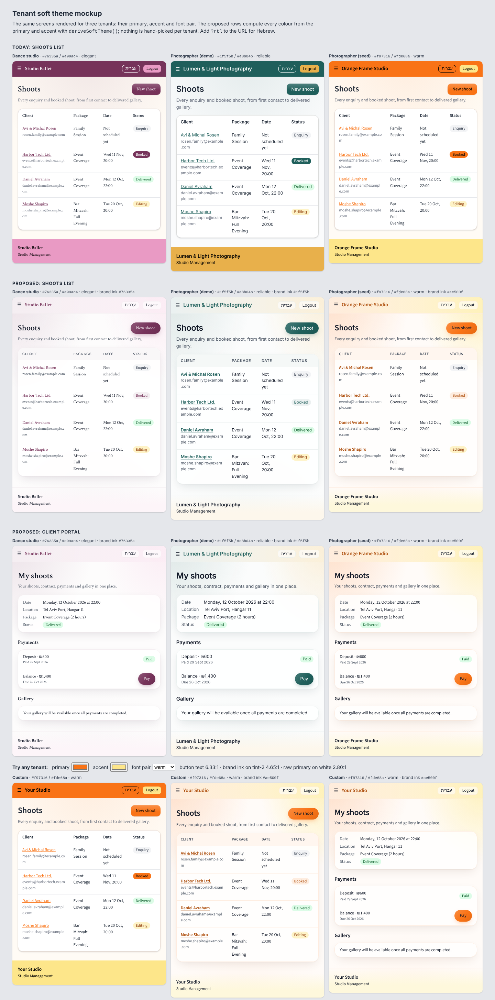

# Soft, gradient-led theme derived from each tenant's brand

> Status: research and proposal only. No app code is changed by this PR.
> Date: 2026-10-30
> **Scope (revised by the owner mid-task):** proposals may be global, for every tenant including dance. The focus is per-tenant customisation: the Light Blue / OpalSwift-style look is derived from each tenant's primary colour, accent and font pair, so every tenant gets it in its own brand.

## Summary

- **The references could not be studied.** This session's network policy blocked `lightbluesoftware.com`, `www.lightbluesoftware.com`, `opalswift.com`, `www.opalswift.com` and `web.archive.org`. I did not reconstruct their design from memory. The comparison's "Reference" column is blank, and values to tune once they're captured are marked **(verify)**. `docs/design/research/capture-references.js` captures them (screenshots plus computed colours, gradients, fonts, radii, shadows, motion) once the hosts are allowed.
- **The proposed look is a derived token system, not a palette.** A new `deriveSoftTheme(primary, accent)`, called from `useThemeInjection`, computes:
  - four tints of the primary and two of the accent at **fixed luminance targets**, so every brand colour gets equally subtle washes;
  - a **contrast-safe "brand ink"** (the primary, darkened only as far as needed for 4.5:1 when used as text);
  - a **button fill** with a WCAG-correct text colour.
  
  CSS then builds the gradients (page wash, header, footer), glass surfaces and soft shadows from those tokens. The font pair still drives typography; pairs gain heading weight and tracking.
- **It fixes contrast failures that exist today.** For tenants with a light or mid-tone primary (the photographer seed `#F97316`, therapist `#4CAF50`, any yellow or pastel), the brand colour used as text (81 `text-primary` uses) measures **1.5–2.8:1** on white. The muted grey `#6b7280` measures **4.24:1** on any tint. Both fail AA. In the proposed system every sample tenant clears AA on every pairing (section 5).
- **Decided (owner, 2026-10-30):** the soft gradient look is the **default for every tenant**, using each tenant's own primary and accent as the tint colours. Tenants can switch their header and footer back to solid brand colour (T13, Phase 2). Logo contrast on the new light header is checked at upload and fixed automatically at render time (T14, Phase 2).
- **Mockup:** `docs/design/tenant-theme-mockup.html` renders the shoots list and client portal for three tenants (dance burgundy + Elegant pair, photographer teal + Reliable, photographer orange + Warm), shown as they look today and as proposed. A colour picker re-derives everything live, and `?rtl` switches to Hebrew.



---

## 1. Reference sites: not captured

| Host | Result |
|---|---|
| `lightbluesoftware.com`, `www.lightbluesoftware.com` | Proxy `CONNECT 403` (policy denial); WebFetch `ENOTFOUND` |
| `opalswift.com`, `www.opalswift.com` | Same |
| `web.archive.org` (fallback) | Proxy 403 |

**To unblock:** add the hosts in the cloud environment's settings (environment menu in the session title bar → Edit → Network access → Allowed domains). Steps: https://code.claude.com/docs/en/cloud-environments#network-access. Then run `NODE_PATH=$(npm root -g) node docs/design/research/capture-references.js` and fill the blank column in section 3.

---

## 2. How tenant theming works today

### Data (table `tenants`, migration `20260608000200_core_tenants.sql`)

| Column | Default | Notes |
|---|---|---|
| `primary_color` | `'#76335a'` NOT NULL | The dance school's burgundy. Every tenant that never changed it is burgundy. |
| `accent_color` | `'#e99ac4'` NOT NULL | The dance school's mauve. **Every tenant has an accent**: one that never picked an accent silently gets dance mauve. The "no accent" code path in `deriveColorSystem` is never reached from the DB. |
| `font_pair` | nullable | `reliable` / `elegant` / `dynamic` / `warm` / `bold`; null means `reliable`. |
| `logo_url`, `logo_dark_url` | nullable | Rendered from the tenant object by components. |
| `skin` | | Vertical (`photographer`, `dance-studio`, …), exposed as `tenant.vertical`. |

### Pipeline

1. `useTenant()` (`hooks/useTenant.ts`) fetches the row and builds `white_label = { primary_color, accent_color, logo_url, logo_dark_url }`.
2. `useThemeInjection()` (`hooks/useThemeInjection.ts`, mounted once in `App.tsx`) runs on tenant change:
   - `deriveColorSystem(primary, secondary_color || accent_color)` (`lib/utils.ts`) returns `primary`, `primary_dark/light/hover/active`, and the same five for `secondary`. Variants come from `darkenColor()`, which **subtracts a fixed amount from each RGB channel** (hover −9%, active −17%, dark −15%, light +15%). Each key becomes `--color-<key>` on `<html>`.
   - `--color-on-primary` / `--color-on-secondary` come from `getAccessibleTextColor()`: black if *perceived* brightness `(0.299R + 0.587G + 0.114B)/255 > 0.5`, else white. **This is not the WCAG ratio.** It happens to be right for all samples tested, but it can pick the lower-contrast option for mid-tones.
   - `--color-bg-primary/secondary` switch to a warm (`#fffbf5`) or cool (`#fafbfc`) off-white depending on `R > B`.
   - `--logo-url` / `--logo-dark-url` are set only from `white_label.logo.url`, a shape `useTenant` never produces. Nothing reads these variables, so this branch is dead code.
   - `injectFontPair(tenant.font_pair)` sets `--font-en`, `--font-he`, `--font-family-sans`, `--font-family-hebrew`. (`useFontLoader()` does the same, but nothing mounts it.)
3. `index.css` layers:
   - **Layer 1 primitives** (`--color-primary…`, status colours, neutral scale). Note: `--color-neutral-*` is a fixed warm grey; the comment says it is "derived from primary" but nothing derives it.
   - **Layer 2 semantics** (`--color-text-primary #1f2937`, `--color-text-secondary #6b7280`, borders, surfaces).
   - **Finish layer** (DL-DESIGN-009): `--tint-primary-05/10/15/25` (`color-mix` of primary with transparent), `--shadow-ink`, `--border-hairline`, `--focus-halo`, `--sheen-raised`, `--edge-emboss`, `--wash-brand` (one centred radial at 10% primary), radius ramp 4/6/10/14/20.
   - Component classes (`.card`, `.btn-*`, `.form-*`).
4. `tailwind.config.js` maps `primary`, `secondary`, `on-primary`, `accent`, status colours to the CSS variables. **`text-primary` and `bg-primary` therefore share one value**, so the brand colour as text has no contrast guard.
5. Chrome: `AppHeader.tsx` is solid `bg-primary`; the footer in `AppLayout.tsx` is solid `bg-secondary`.

### Weaknesses this proposal addresses

| # | Weakness | Effect |
|---|---|---|
| W1 | Primary used as text has no contrast guard | Orange / green / yellow / pastel tenants: links, brand name and active states at 1.5–2.8:1 |
| W2 | `#6b7280` muted text | 4.24:1 on any tint; fails AA wherever a tinted surface sits behind captions |
| W3 | Tints are fixed percentages (`color-mix` 10%) | 10% of yellow is invisible; 10% of navy is heavy. Brands get unequal "subtlety" |
| W4 | `getAccessibleTextColor` uses perceived brightness, not WCAG | Risky for mid-tones |
| W5 | `darkenColor` subtracts RGB evenly | Hover states drift in hue and saturation for saturated colours |
| W6 | Accent default is dance mauve for everyone | Non-dance tenants inherit pink accents unless they change it |
| W7 | Solid primary header + solid accent footer | The heaviest elements on every page; opposite of the soft look |

---

## 3. Comparison, area by area

"Reference" is intentionally blank (section 1). "Brief" is the owner's direction.

| Area | Reference | Brief | Ours today | Gap |
|---|---|---|---|---|
| Colour / gradients | *not captured* | Subtle gradient colouring | One centred 10% radial, hidden under a solid header | No multi-hue, low-contrast atmosphere; colour spent on chrome |
| Header / nav | *not captured* | Light, airy | Solid primary bar | Heavy; reads as admin tool |
| Footer | *not captured* | | Solid accent block | Loudest element with light accents (mustard, mauve, pale yellow) |
| Surfaces | *not captured* | Soft, glassy | Opaque white, 14px, crisp shadow | No translucency, so the wash can't show through |
| Typography | *not captured* | | Font pair sets family only; headings 700 everywhere | Pairs can't express heading weight or tracking **(verify)** |
| Buttons / inputs | *not captured* | | Solid primary, 10px, sheen | Fine; pill + coloured glow would soften |
| Tables / lists | *not captured* | Whitespace | Dense rows, bold header, grey lines | No header tint or hover |
| Empty states | *not captured* | | Plain sentence in a white card | No tint, icon or warmth |
| Imagery | *not captured* | | Package covers exist but aren't shown in lists or portal | Photographers sell images; the UI shows none |

---

## 4. The derived token system

### 4.1 Derivation (JS, once per tenant)

New file `apps/web/src/lib/theme/deriveSoftTheme.ts`; reference implementation in `docs/design/research/derive-theme.mjs`. Called from `useThemeInjection` next to `deriveColorSystem`; each returned key is written to `<html>` like today.

```ts
const INK = '#111827';   // body text
const MUTED = '#4b5563'; // muted text (replaces #6b7280)
const TINT_TARGETS = { ground: 0.97, t1: 0.93, t2: 0.87, t3: 0.78 }; // WCAG relative luminance

export function deriveSoftTheme(primary: string, accent: string) {
  const t = mapValues(TINT_TARGETS, (L) => tintTo(primary, L)); // mix toward white until luminance == L
  const a = mapValues(TINT_TARGETS, (L) => tintTo(accent, L));
  const fill = contrast(onColor(primary), primary) >= 4.5
    ? primary
    : pushUntil(primary, [WHITE], BLACK, 4.5);                     // darken only if no text colour passes
  return {
    '--color-primary-fill': fill,
    '--color-on-primary-fill': onColor(fill),                     // white or INK, whichever has the higher WCAG ratio
    '--color-on-primary': onColor(primary),                       // replaces getAccessibleTextColor
    '--color-primary-ink': pushUntil(primary, [WHITE, t.ground, t.t1, t.t2], BLACK, 4.5),
    '--color-accent-ink': pushUntil(accent, [WHITE, a.ground, a.t1, a.t2], BLACK, 4.5),
    '--tint-ground': t.ground, '--tint-1': t.t1, '--tint-2': t.t2, '--tint-3': t.t3,
    '--tint-accent-1': a.t1, '--tint-accent-2': a.t2,
    '--color-text-primary': INK, '--color-text-secondary': MUTED,
  };
}
```

Why JS rather than pure `color-mix()`:
- **Equal visibility:** a luminance target needs a solve (bisection, 24 steps). Fixed percentages can't do it (W3).
- **Guaranteed contrast:** `pushUntil` checks the WCAG ratio against the real surfaces. CSS can't measure contrast. `contrast-color()` only picks black or white and can't darken a brand colour to a target ratio.
- **Cost:** one function, under 1 ms, runs once per tenant load.

Why tints are opaque colours rather than alpha: an opaque tint has a known luminance, so the contrast numbers below hold on any page. Fades use `color-mix(in srgb, var(--tint-n) X%, transparent)` on top of a known ground.

### 4.2 Composition (CSS, `index.css`, replaces the `--wash-brand` block)

```css
:root {
  /* Fallbacks before the tenant loads = dance defaults, so first paint matches */
  --tint-ground: #fdfcfc; --tint-1: #f9f7f8; --tint-2: #f4eff2; --tint-3: #ece2e8;
  --tint-accent-1: #fdf5f9; --tint-accent-2: #fbecf4;
  --color-primary-ink: var(--color-primary);
  --color-primary-fill: var(--color-primary);
  --color-on-primary-fill: var(--color-on-primary);

  --wash-page:
    radial-gradient(75% 60% at 0% 0%,    var(--tint-3),        transparent 70%),
    radial-gradient(60% 55% at 100% 0%,  var(--tint-accent-2), transparent 70%),
    radial-gradient(70% 45% at 50% 100%, var(--tint-1),        transparent 75%);
  --gradient-header: linear-gradient(90deg,
    color-mix(in srgb, var(--tint-2) 88%, transparent),
    color-mix(in srgb, var(--tint-accent-2) 88%, transparent));
  --gradient-footer: linear-gradient(180deg, transparent, var(--tint-accent-1) 70%);
  --surface-glass: color-mix(in srgb, #fff 78%, transparent);
  --border-glass: color-mix(in srgb, var(--tint-3) 60%, #fff);
  --elevation-soft: 0 1px 2px color-mix(in srgb, var(--shadow-ink) 6%, transparent),
                    0 10px 28px -8px color-mix(in srgb, var(--shadow-ink) 14%, transparent);
  --glow-primary: 0 6px 16px -6px color-mix(in srgb, var(--color-primary-fill) 55%, transparent);

  --wash-brand: var(--wash-page);            /* body already paints --wash-brand */
  --color-bg-primary: var(--tint-ground);
}
[dir="rtl"] {                                /* primary glow stays at inline-start */
  --wash-page:
    radial-gradient(75% 60% at 100% 0%,  var(--tint-3),        transparent 70%),
    radial-gradient(60% 55% at 0% 0%,    var(--tint-accent-2), transparent 70%),
    radial-gradient(70% 45% at 50% 100%, var(--tint-1),        transparent 75%);
  --gradient-header: linear-gradient(270deg,
    color-mix(in srgb, var(--tint-2) 88%, transparent),
    color-mix(in srgb, var(--tint-accent-2) 88%, transparent));
}
```

`dir` and the tokens both live on `<html>`, so the RTL block overrides cleanly. The warm/cool off-white switch (`getBackgroundForPrimaryColor`) is no longer needed: `--tint-ground` already carries the brand's own warmth.

### 4.3 Proposals

All global unless noted. Every proposal changes dance too; dance's own row in section 5 shows it stays AA and keeps its burgundy and mauve character.

| # | Change | Files | Effort | Impact |
|---|---|---|---|---|
| T1 | **`deriveSoftTheme` + tokens** (4.1, 4.2) | new `lib/theme/deriveSoftTheme.ts` (+ unit tests on the section 5 matrix); `useThemeInjection.ts`; `index.css` | M | foundation |
| T2 | **Brand ink for text.** Tailwind: `theme.extend.textColor.primary = 'var(--color-primary-ink)'` so the 81 `text-primary` uses become safe automatically, while `bg-primary` keeps the raw brand. Same for `text-accent`. Also links and `.form-label` accents | `tailwind.config.js` | S | high (fixes W1) |
| T3 | **Muted text `#4b5563`** and body ink `#111827` | `index.css` Layer 2 | S | med (fixes W2) |
| T4 | **Soft header:** `--gradient-header` + `backdrop-filter: blur(12px) saturate(1.3)`, ink text, brand name in `--color-primary-ink`, outline buttons on `--border-glass` | `AppHeader.tsx` (swap `bg-primary text-on-primary` for an `app-header` class) | S | high |
| T5 | **Soft footer:** `--gradient-footer`, ink text | `AppLayout.tsx` | S | high |
| T6 | **Glass surfaces:** `.card` / `Card` use `--surface-glass`, `--border-glass`, `--elevation-soft`, `--radius-surface: 18px` **(verify)**. Inputs and modals stay opaque white. | `index.css`, `card.tsx` | S | med-high |
| T7 | **Tables:** `thead` on `--tint-1`, rows divided by `--tint-2`, hover `--tint-1`, `padding-block: .75rem`; small uppercase headers in LTR only | `table.tsx` (also replaces hardcoded `border-gray-200`) | S | med |
| T8 | **Primary buttons:** `--color-primary-fill` + `--color-on-primary-fill`, pill radius, `--glow-primary`, overlay-only sheen (keeps the existing rule) | `button.tsx`, `index.css` `.btn-primary` | S | med |
| T9 | **Badges:** "brand" status badge (Booked) as `--tint-2` with `--color-primary-ink` text instead of a solid fill | `badge.tsx` | S | low-med |
| T10 | **WCAG-based on-colour** replaces `getAccessibleTextColor`; perceptual hover/active (mix toward black in sRGB: `mix(primary, #000, .91/.83)`) replaces `darkenColor` | `lib/utils.ts` | S | low (fixes W4/W5) |
| T11 | **Accent default.** Make `accent_color` nullable. When null, derive an analogous accent (`hsl(h+30, s·0.85, l)`), so new non-dance tenants stop inheriting mauve. Existing rows keep their value; the dance tenant sets its mauve explicitly first. | migration + `deriveColorSystem` | M | med (fixes W6) |
| T12 | **Font pairs get heading settings:** `FontPair` gains `headingWeight` and `headingTracking` (LTR only), exposed as `--heading-weight` / `--heading-tracking` and used by `text-h1..h3` and `Display`. Proposed values: Reliable 600 / −0.02em; Elegant 600 / 0; Dynamic 600 / −0.01em; Warm 600 / −0.01em; Bold 500 / 0.01em. **(verify)** | `useFontLoader.ts`, `index.css` typography | S | med |
| T13 | **Header & footer style: Soft (default) / Solid.** New column `tenants.chrome_style text not null default 'soft' check (chrome_style in ('soft','solid'))`, a radio with live preview in branding settings, and `data-chrome` on `<html>` set by `useThemeInjection`. `solid` uses `--color-primary-fill` / `--color-on-primary-fill` (header) and the accent fill (footer), so it stays AA. Only the chrome switches: page wash, glass cards and tables stay soft for everyone. No per-element toggles and no intensity slider. | migration + `BrandingSettingsForm.tsx` + `useThemeInjection.ts` + `AppHeader.tsx` / `AppLayout.tsx` | M | med (escape hatch for brands and for logos made for a dark bar) |
| T14 | **Logo contrast: check at upload, auto-fix at render.** See 4.4. | `BrandingSettingsForm.tsx`, new `lib/theme/logoTone.ts`, `AppHeader.tsx`, migration (3 columns) | M | high (prevents invisible logos on day one) |

#### Contrast per proposal

- T2: brand ink ≥ 4.5:1 on white, ground, tint-1 and tint-2 **by construction**; matrix lowest is 4.58 (yellow).
- T3 / T4 / T5 / T7: text sits only on white, ground, tint-1..3 or accent tint-1/2. All have luminance ≥ 0.78, so ink stays ≥ 14:1 and muted ≥ 6.6:1 (tint-2) / about 6:1 (tint-3) for any brand. Luminance-targeted tints make this hue-independent.
- T8: fill ratio ≥ 4.5:1 by construction; matrix lowest is 6.33 (orange with ink text).
- T9: ink on tint-2 is the same guarantee as T2.
- Status badges (success / warning) keep their fixed palettes, unaffected by tenants.
- Focus ring: `--focus-halo` stays; the 2px solid outline should use `--color-primary-ink` so it reaches 3:1 non-text contrast for light brands (today a yellow outline on white is 1.5:1).

#### RTL notes

- Gradients with direction (page wash, header) are mirrored in a `[dir="rtl"]` block, so the primary always sits at inline-start. The footer fade is vertical and needs nothing.
- Hebrew: no `text-transform`, `letter-spacing: 0` on headers and table heads (T7, T12); the existing RTL line-heights stay.
- Hebrew pair faces (Heebo, Frank Ruhl Libre, Rubik, Assistant, Miriam Libre) render correctly in the mockup with `?rtl`.
- Email addresses inside Hebrew rows should carry `dir="ltr"` (done in the mockup).

---

### 4.4 Logo contrast (T14)

**Why:** `AppHeader.tsx` shows `tenant.logo_url` on today's solid primary bar. Many tenants will have uploaded a white or light logo made for that bar. On the light soft header, such a logo can all but disappear.

**Standard:** WCAG exempts logos from the text-contrast rule (1.4.3, "logotypes"), so this is about visibility rather than compliance. Target **3:1** (the non-text contrast level) between the logo's visible pixels and the header behind it.

#### Check (at upload, and once for existing logos)

New `lib/theme/logoTone.ts` draws the image on a small canvas (max 128px):
- **Logo colour:** the average WCAG luminance of pixels with alpha > 0.5.
- **Saturation spread:** whether the logo is close to one colour (`mono: true`) or multi-colour.
- **Built-in background:** whether the four corners are opaque, i.e. the logo is a JPEG or PNG with its own background box.

It returns `{ luminance, mono, hasPlate }`. It is stored in three new columns, `logo_luminance`, `logo_mono`, `logo_has_plate`, and the same for the dark-mode logo.

- **At upload** the file is read locally (`FileReader` → `createImageBitmap`), so cross-site image loading (CORS) isn't involved.
- **Existing tenants:** a one-off backfill runs the same check the first time an admin opens branding settings. This needs the `tenant-assets` bucket to send CORS headers for public objects **(verify)**. If it doesn't, the backfill can run in an Edge Function with an image decoder instead.
- **SVG** logos are rasterised by the same canvas path.

The header's background colour is known (`--tint-2` and `--tint-accent-2` for Soft, `--color-primary-fill` for Solid), so the ratio is plain arithmetic, both in the browser and in the settings preview.

#### Automatic fix (render time; the uploaded file is never changed)

`AppHeader` picks the first option that reaches 3:1:

| Order | Fix | When it applies | Effect |
|---|---|---|---|
| 1 | **Use the other uploaded logo** | Tenant has both logos and the other one passes | No visual compromise: the tenant's own artwork |
| 2 | **Logo already has a background** | `hasPlate` (corners opaque) | Already readable on any header; just round its corners to `--radius-sm` |
| 3 | **Recolour to brand ink** | `mono` is true (one-colour logo, e.g. white wordmark) | Render as `<span>` with `mask: url(logo) center/contain no-repeat; background: var(--color-primary-ink)`. The logo shape, painted in the tenant's darkened brand colour, which is AA by construction. Works for PNG with transparency and SVG. |
| 4 | **Brand-colour plate** | Multi-colour logo that fails | Logo on a small pill (`background: var(--color-primary-fill)`, `padding: 4px 10px`, `border-radius: 999px`). The logo appears on the colour it was designed for; the rest of the header stays soft. |
| 5 | Nothing passes | Very rare (e.g. a mid-grey multi-colour logo on a mid-tone fill) | Keep option 4 and show the warning below |

**Settings UI (`BrandingSettingsForm`):**
- Previews show the logo on the Soft and Solid headers side by side.
- When a fix is active, a non-blocking note explains what it did and offers alternatives, e.g. "Your logo is light, so on the soft header we show it in your brand colour. Upload a dark version, or switch to the solid header, to use it as-is."
- An "Use my logo exactly as uploaded" checkbox stores `logo_autofix = false`, for tenants who really don't want automatic changes.

Never automatic: switching the tenant to Solid on their behalf (that's their branding choice), and editing or re-uploading the image file.

**RTL:** none of this depends on direction; the mask and the plate centre the logo with `center`.

**Effort:** M. About 1 day for `logoTone` + tests (white wordmark, black wordmark, multi-colour PNG, JPEG with a white box, SVG), 1 day for the header rendering + settings preview, and half a day for the migration + backfill.

## 5. Contrast test matrix

Generated by `node docs/design/research/derive-theme.mjs` (saved as `research/contrast-matrix.md`). WCAG 2.x ratios. "Today" columns use the current code paths.

| Tenant | Primary / accent | On-primary today → proposed (ratio) | Button fill (ratio) | Primary as text on white → brand ink on tint-2 | Body ink on tint-2 / tint-3 | Muted today → proposed on tint-2 |
|---|---|---|---|---|---|---|
| Dance studio (current tenant default) | `#76335a` / `#e99ac4` | white 8.78 → white 8.78 | `#76335a` 8.78 | 8.78 → `#76335a` 7.73 | 15.61 / 14.03 | 4.25 → 6.65 |
| Photographer demo | `#1F5F5B` / `#E8B04B` | white 7.38 → white 7.38 | `#1F5F5B` 7.38 | 7.38 → `#1f5f5b` 6.47 | 15.56 / 14.06 | 4.24 → 6.63 |
| Photographer seed | `#F97316` / `#FDE68A` | black 7.49 → ink 6.33 | `#F97316` 6.33 | **2.80** → `#ae500f` 4.65 | 15.55 / 14.03 | 4.24 → 6.62 |
| Art class seed | `#1D4ED8` / `#93C5FD` | white 6.70 → white 6.70 | `#1D4ED8` 6.70 | 6.70 → `#1d4ed8` 5.87 | 15.55 / 14.07 | 4.24 → 6.62 |
| Therapist seed | `#4CAF50` / `#C8E6C9` | black 7.56 → ink 6.38 | `#4CAF50` 6.38 | **2.78** → `#357a38` 4.61 | 15.56 / 14.03 | 4.24 → 6.63 |
| Sofer seed | `#6D1A36` / `#D4A5B6` | white 11.34 → white 11.34 | `#6D1A36` 11.34 | 11.34 → `#6d1a36` 9.97 | 15.60 / 14.04 | 4.25 → 6.64 |
| Stress: light yellow | `#FACC15` / `#afe926` (derived) | black 13.71 → ink 11.58 | `#FACC15` 11.58 | **1.53** → `#826a0b` 4.58 | 15.55 / 14.10 | 4.24 → 6.62 |
| Stress: pale sky | `#93C5FD` / `#9d9bf5` (derived) | black 11.65 → ink 9.84 | `#93C5FD` 9.84 | **1.80** → `#526e8e` 4.65 | 15.64 / 14.02 | 4.26 → 6.66 |
| Stress: near-black | `#111827` / `#161325` (derived) | white 17.74 → white 17.74 | `#111827` 17.74 | 17.74 → `#111827` 15.55 | 15.55 / 14.06 | 4.24 → 6.62 |

Reading it:
- **Bold** = fails AA today. Every proposed column is ≥ 4.5.
- Dark brands (dance, teal, sofer, navy) keep their exact primary as ink; only light brands get darkened ink.
- The on-primary change from pure black to `#111827` lowers ratios slightly, but all stay ≥ 6.3. Keeping `#000` is also fine if preferred.
- Suggested unit test: assert every proposed column ≥ 4.5 for these 9 rows plus ~200 random colours.

---

## 6. Mockup

`docs/design/tenant-theme-mockup.html` (static, not wired into the app, fonts bundled in `docs/design/fonts/`):

- **Rows:** Today, shoots list · Proposed, shoots list · Proposed, client portal · a custom tenant from colour pickers.
- **Columns:** Dance studio `#76335a` / `#e99ac4` + Elegant (Crimson Text / Frank Ruhl Libre) · Photographer demo `#1f5f5b` / `#e8b04b` + Reliable (Inter / Heebo) · Photographer seed `#f97316` / `#fde68a` + Warm (Source Sans 3 / Rubik).
- All proposed colours are computed by the inline copy of `deriveSoftTheme()`; nothing is hand-tuned per tenant.

Screenshots: [1440](research/tenant-mockup-1440.png) · [1440 Hebrew RTL](research/tenant-mockup-1440-rtl.png) · [390](research/tenant-mockup-390.png)

Things to notice: the orange tenant's links turn into a burnt orange that passes AA (`#ae500f`). The dance tenant keeps its burgundy and pink identity, now as a blush wash instead of a pink footer slab.

---

## 7. Phased plan

| Phase | Items | Effort | Result |
|---|---|---|---|
| 1. Foundation + contrast | T1, T2, T3, T10 | 2–3 days | Derived tokens exist; all brand-as-text and muted text pass AA for any tenant. Visually small. |
| 2. The soft look (default for all tenants) | T4, T5, T6, T7, T8, T9 + **T13** (Soft/Solid choice) + **T14** (logo check and auto-fix) | 5–6 days | Gradient header/footer, page wash, glass cards, airy tables, pill buttons, for every tenant in its own colours; tenants can keep a solid bar; no invisible logos |
| 3. Typography | T12 | 1 day | Pairs control heading weight and tracking |
| 4. Data model | T11 | 1–2 days (migration) | No more inherited dance mauve |
| Later | Imagery in lists/portal (package covers, portal hero with scrim), tinted empty states, status stepper, motion | 1–2 weeks | Product feels like a studio tool |

**Before Phase 2 ships:** capture the references and tune the **(verify)** values (tint targets, radius, heading weights). Run visual regression on the dance tenant and get the owner to sign off on its new look, since dance is no longer protected.

### Top 5

1. `deriveSoftTheme()`: luminance-targeted tints plus contrast-safe brand ink and button fill, computed per tenant in `useThemeInjection` (T1).
2. Point `text-primary` at the brand ink and switch muted text to `#4b5563`, fixing today's AA failures for light-brand tenants (T2, T3).
3. Soft gradient header and footer by default for every tenant, with a Soft/Solid choice and automatic logo-contrast fixes shipped alongside (T4, T5, T13, T14).
4. Multi-stop page wash (primary corner + accent corner + bottom glow) behind glass cards with soft, brand-tinted shadows (4.2, T6).
5. Font pairs carry heading weight and tracking, so Elegant/Reliable/Warm feel distinct under the same soft system (T12).

---

## 8. Files in this PR

- `docs/design/photographer-theme-proposal.md`: this document
- `docs/design/tenant-theme-mockup.html` + `docs/design/fonts/*.woff2` (copied from the app's `@fontsource` packages, OFL)
- `docs/design/research/derive-theme.mjs`: reference derivation + matrix generator
- `docs/design/research/contrast-matrix.md`: generated matrix
- `docs/design/research/tenant-mockup-*.png`: mockup screenshots
- `docs/design/research/ours/*.png`: current photographer demo (shoots list, shoot detail, quote, client portal, pay page; 1280 + 390; Hebrew)
- `docs/design/research/capture-references.js`: reference capture, to run once the hosts are allowed

## 9. Sources

- Code: `supabase/migrations/20260608000200_core_tenants.sql:98-99`, `supabase/seed-*.sql`, `apps/web/src/hooks/useTenant.ts`, `apps/web/src/hooks/useThemeInjection.ts`, `apps/web/src/lib/utils.ts` (`deriveColorSystem`, `darkenColor`, `getAccessibleTextColor`, `getBackgroundForPrimaryColor`), `apps/web/src/hooks/useFontLoader.ts`, `apps/web/src/fonts.ts`, `apps/web/src/index.css`, `apps/web/tailwind.config.js`, `apps/web/src/components/Navigation/AppHeader.tsx:29`, `apps/web/src/layouts/AppLayout.tsx:45`, `apps/web/src/components/ui/{card,table,badge,button}.tsx`, `DESIGN_SYSTEM.md`, `apps/web/DESIGN_SYSTEM.md`.
- Demo build: `VITE_DEMO_MODE=true pnpm --filter web build`, served from `apps/web/dist-demo`, captured with Playwright (Chromium).
- References: https://www.lightbluesoftware.com/ and https://opalswift.com/ were **not reachable** (section 1).
